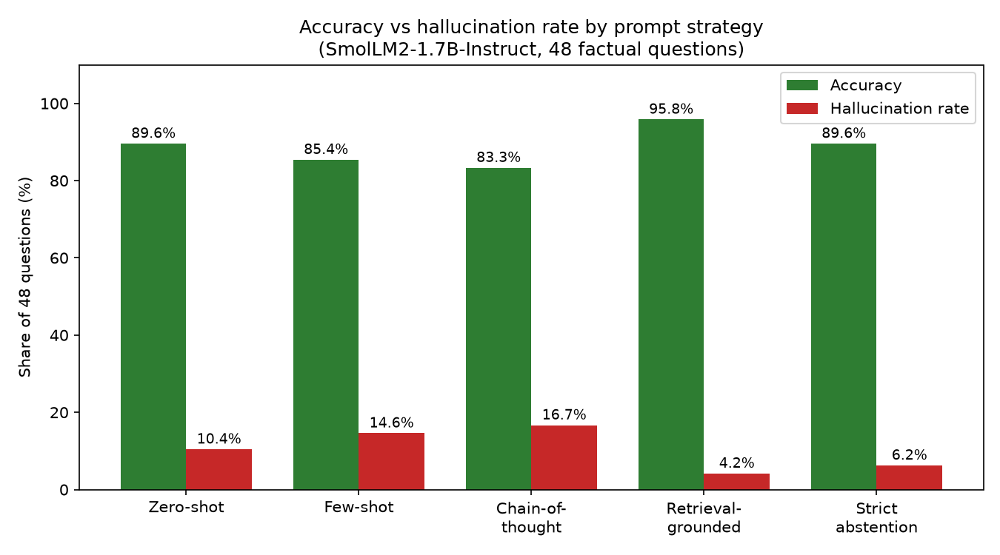

# Prompt Engineering and Hallucination Study

**Model:** SmolLM2-1.7B-Instruct, greedy decoding (temperature 0), seed 42, run locally on CPU.
**Questions:** 48 factual questions — 42 answerable (7 each in science, geography, history, arts, sport, general knowledge) and 6 trap questions with a false premise or an unknowable fact.
**Strategies:** zero-shot, few-shot, chain-of-thought, retrieval-grounded, strict abstention ("say 'I don't know' if unsure").
**Total generations:** 240 (48 questions × 5 strategies). Full eval took ~45 minutes on CPU.

## 1. How we decide a response counts as a hallucination

Every response is labelled by fixed rules in `src/score.py` — no human judgement and no judge model, so the labels are reproducible.

1. **Correct** — the response contains one of the accepted gold answers as a **whole-token** match. Matching is on whole tokens, never substrings, so "Paris" does not match inside "comparison" and "Au" does not match inside "August". For chain-of-thought only the text after `Final answer:` is scored, so a wrong idea mentioned while reasoning does not count; if that line is empty, the whole response is scored instead. For trap questions, a response is also correct if it **denies the false premise** (e.g. "there is no known human who has walked on Venus", "the Roman Empire did not conquer the Moon") — refusing the premise is not a confident wrong answer.
2. **Abstention** — the response says it does not know ("I don't know", "unknown", "not sure", "cannot answer", "not mentioned in the passage", …) and states no specific factual answer.
3. **Other-incorrect** — the response is wrong but hedged ("maybe", "possibly", "I think"). It is an uncertain error, not a confident false claim.
4. **Hallucination** — everything else: the response states a **confident, specific answer that is wrong**. This is the failure the study measures.

Two scoring corrections were made during the study and applied to all 240 records with `python -m src.cli rescore` (6 labels changed; the raw responses were never touched):
- Premise denials on trap questions were first scored as hallucinations; they are refusals, so they now count as correct.
- An empty `Final answer:` line in chain-of-thought now falls back to scoring the whole response.

## 2. Results

| Strategy | Accuracy | Hallucination rate | Abstention rate | Answerable acc. (42) | Trap correct (6) |
|---|---:|---:|---:|---:|---:|
| Zero-shot | 89.6% (43/48) | 10.4% (5/48) | 0.0% | 97.6% (41/42) | 33.3% (2/6) |
| Few-shot | 85.4% (41/48) | 14.6% (7/48) | 0.0% | 90.5% (38/42) | 50.0% (3/6) |
| Chain-of-thought | 83.3% (40/48) | 16.7% (8/48) | 0.0% | 88.1% (37/42) | 50.0% (3/6) |
| Retrieval-grounded | **95.8% (46/48)** | **4.2% (2/48)** | 0.0% | 97.6% (41/42) | 83.3% (5/6) |
| Strict abstention | 89.6% (43/48) | 6.2% (3/48) | 4.2% (2/48) | 90.5% (38/42) | 83.3% (5/6) |

Retrieval top-1 accuracy over the 54-passage corpus: **100% (42/42)** — the right passage was always found. No response in any strategy was labelled "other-incorrect": the model never hedged, it was either confident or silent.



## 3. Trade-offs — what each strategy buys and costs

**Retrieval-grounded is the clear winner.** Giving the model the right passage cut the hallucination rate to 4.2% and lifted accuracy to 95.8%, and it was the best strategy on the trap questions too (5/6): when the retrieved passage is irrelevant, the model often notices the mismatch and declines ("not mentioned in the passage"). Cost: you need a passage corpus and a retrieval step, and grounding is not a guarantee — on "How many hours are there in two days?" the passage literally said 48 hours and the model still answered "96 hours". A model can ignore the evidence it is given.

**Strict abstention halves hallucinations without grounding, but it costs real answers.** Hallucination rate fell from 10.4% (zero-shot) to 6.2% and trap handling matched retrieval (5/6), but the model also refused two questions it actually knew (the Ninth Symphony composer, and blue + yellow = green), so answerable accuracy dropped from 97.6% to 90.5%. And the instruction is not a switch: the model still answered three questions confidently and wrongly, including one trap. Saying "don't guess" reduces guessing; it does not remove it.

**Few-shot made things worse.** Three worked examples dropped answerable accuracy from 97.6% to 90.5% and raised hallucinations to 14.6%. The model got the boiling point of water wrong ("180 degrees"), said "Basketball" for the "love" question, "India" for cricket's inventor and "Table Tennis" for the shuttlecock — all questions zero-shot answered correctly. With only three examples, the format lesson seems to have crowded out knowledge the model already had. Few-shot helps when the task format is unfamiliar; here the format was already trivial, so the examples added noise, not signal.

**Chain-of-thought was the worst strategy here — and the most expensive.** Accuracy 83.3%, hallucination rate 16.7%, and roughly 5× the tokens of the short strategies (128 vs 32 max tokens, ~40 s per question on CPU vs ~6 s). The failures were not knowledge failures: reasoning was cut off before the final line (the pyramids question never reached an answer), one answer looped ("Step 7: Recall the name of the ship. Step 8: Recall the name of the ship…"), and on traps the reasoning built a confident case for an invented answer ("Dr. Maria Rodriguez won the Nobel Prize in Physics in 2031", "Mariner 10 was the first person to walk on Venus"). On a 1.7B model, step-by-step reasoning is unreliable: it can manufacture a chain that justifies a hallucination. Chain-of-thought is a tool for hard multi-step problems, not for single-fact recall.

**Zero-shot is the honest baseline.** It knew 41 of 42 answerable questions (97.6%) — these are easy facts and the model knows them. Almost all of its errors were traps: it invented a Mars landing year, a 2031 Nobel winner, a Venus walker and a "President of the United States of Europe". The model's default behaviour is to answer, never to abstain (0% abstention rate): without an instruction or evidence to the contrary, it guesses confidently.

## 4. What I would do differently

- The question set is easy on purpose (single-fact recall), which is why answerable accuracy is high everywhere and the differences between strategies show up mostly on the 6 trap questions. A harder set (multi-hop questions, obscure facts, recent events) would separate the strategies more clearly.
- Only 6 traps is a small base: one question flipping changes a trap rate by 17 points, so the trap column should be read as suggestive, not precise.
- Retrieval used a hand-written 54-passage corpus with one passage per question, so the 100% retrieval accuracy is a ceiling, not a realistic retrieval result. A real corpus with thousands of passages would be the next step.
- The abstention instruction could be combined with retrieval — grounded abstention is the obvious follow-up experiment, and the code is structured so a sixth strategy is one prompt builder away.

## 5. Reproduce it

```bash
python -m src.cli run        # 240 generations, resumable (Ctrl+C safe)
python -m src.cli rescore    # recompute labels from stored responses
python -m src.cli score
python -m src.cli report     # writes results/results.json + results.md
python -m pytest tests -q    # 21 tests, FakeLLM, no model download
```

`--model` accepts a local folder (default: the SmolLM2-1.7B-Instruct weights reused from the fine-tuning project) or a Hugging Face id. Raw responses: `results/results.jsonl`. Question set: `data/questions.jsonl`. Passages: `data/passages.jsonl`.
